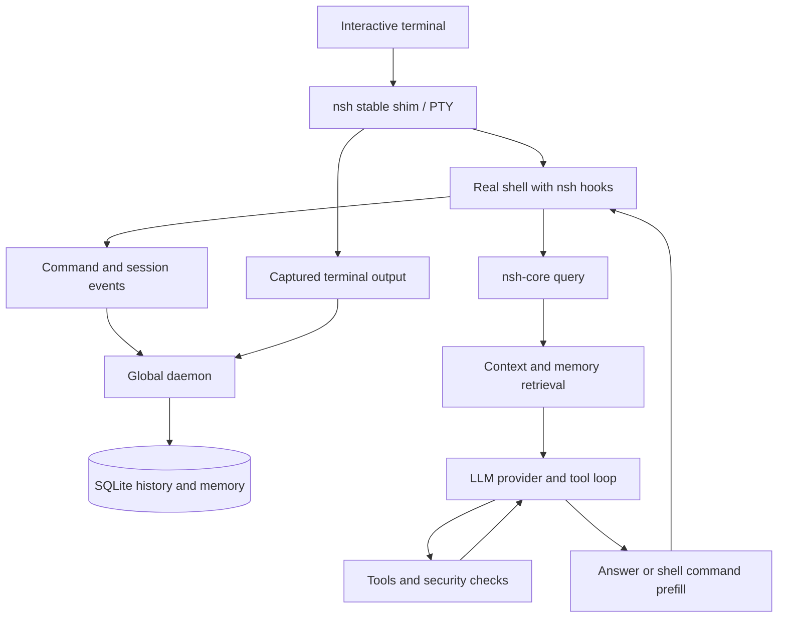

# Runtime flow

## Starting the system
Installation and shell setup introduce nsh into an existing shell environment. The shell-specific integration code is generated through `nsh init`; the `nsh` shim can also wrap an interactive shell in a PTY. The shim deliberately keeps terminal capture separate from the updatable core executable.

`src/shim_main.rs` handles `wrap` itself and dispatches other operations to `nsh-core`. The core parses subcommands and coordinates the global daemon as needed.

## During an interactive session
Shell hooks track command boundaries, exit status, working directory and session identity. The wrapper captures output; command and session events are passed through daemon transport to shared state and SQLite.

A natural-language query travels through the core's query handler. Context gathering combines environment, project and history information; memory retrieval supplements it. The provider streams model output, and the query loop can invoke tools repeatedly. A command suggestion is returned to the shell for prefill, confirmation or configured automatic execution.

## Modes and other entry points
- `nsh query` is the natural-language entry point, with thinking/private/JSON options.
- `nsh record` and daemon-send operations support event recording.
- `nsh chat`, history, session, memory, config and provider commands provide additional workflows.
- `nsh mcp-server` exposes a restricted tool subset over stdio.
- Remote functionality depends on the optional `remote` feature; this is enabled in default Cargo features.

## Runtime diagram

The diagram is a high-level relationship map; specific IPC and capture paths differ by operation and platform.
