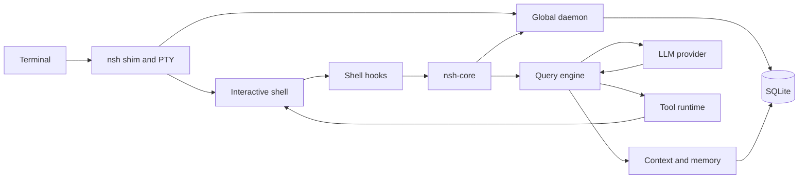
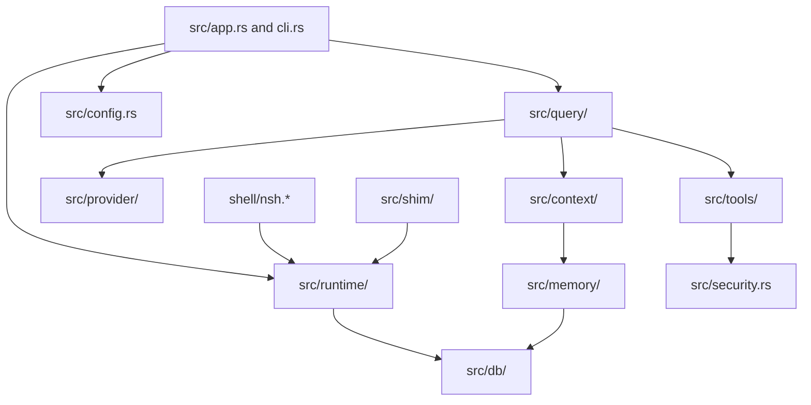
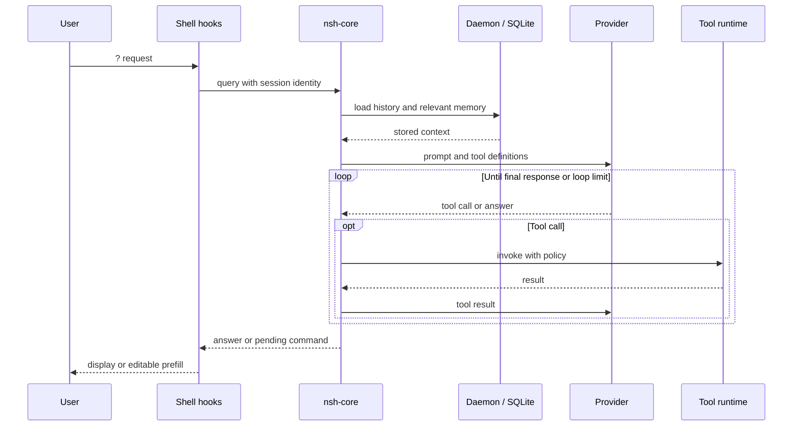

# Architecture diagrams

## Runtime

## Module relationships

## Natural-language query

These diagrams intentionally omit individual IPC messages, background workers and platform-specific capture details.
